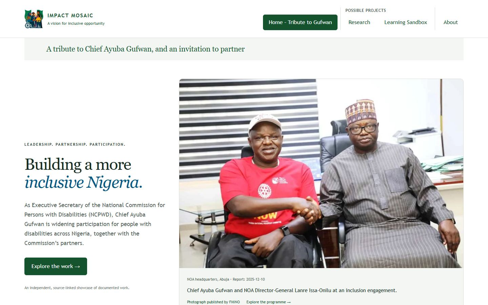
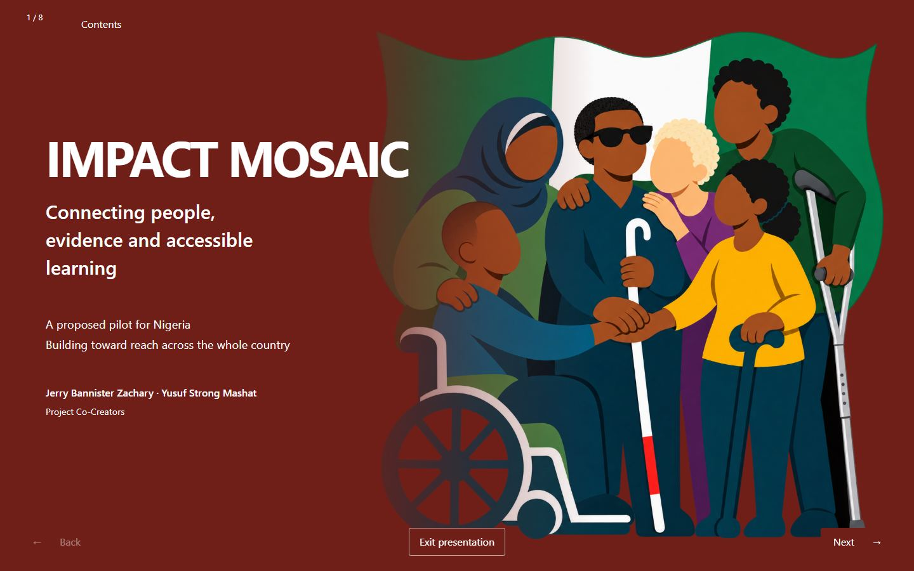
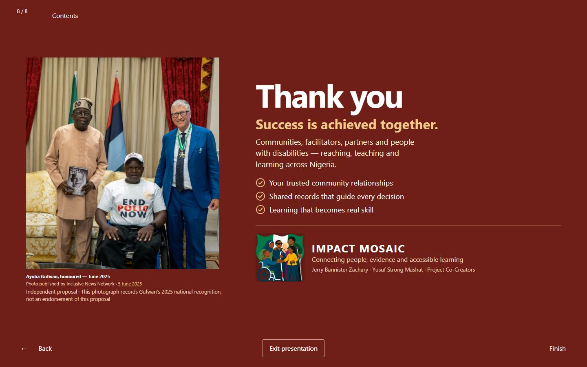
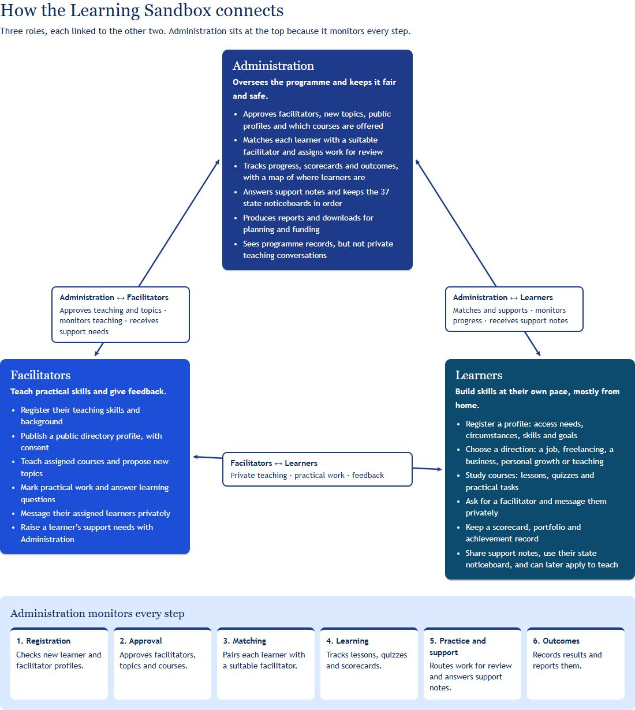
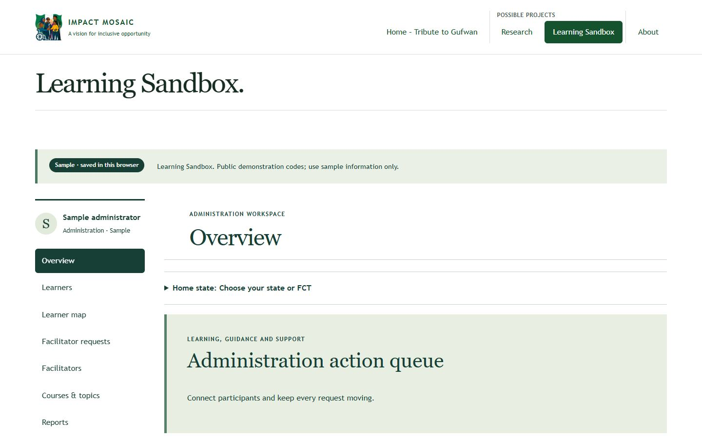
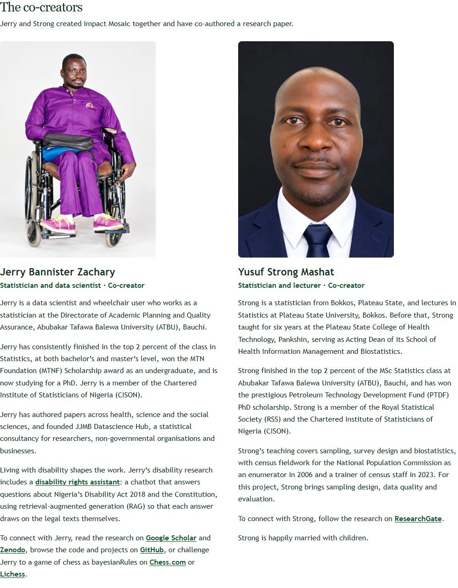
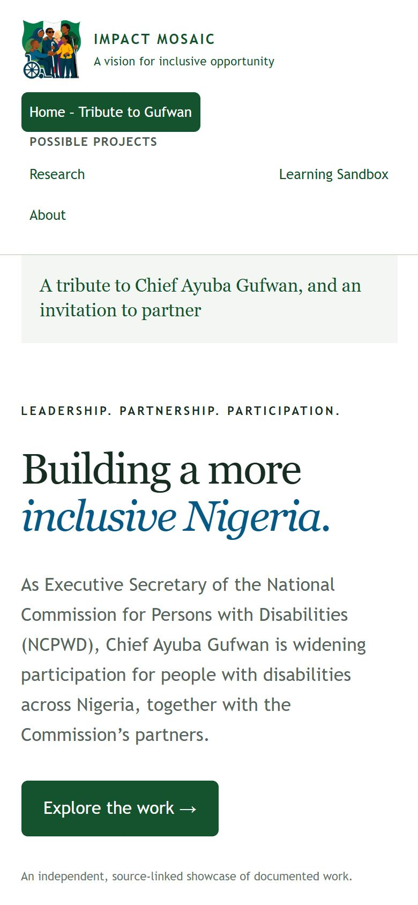

# Impact Mosaic

**A tribute to Chief Ayuba Gufwan, and an invitation to partner.**

Impact Mosaic is an independent website by two Nigerian statisticians. It brings together a source-linked tribute to the disability-inclusion work of Chief Ayuba Gufwan, Executive Secretary of the National Commission for Persons with Disabilities (NCPWD); a research proposal for a reliable, voluntary disability database linked to accessible online teaching; and a working **Learning Sandbox** that shows how learners, facilitators and Administration would work together.

## Visit the site

| Page | Link |
|---|---|
| Home – Tribute to Gufwan | **https://impact-mosaic.pages.dev/** |
| Research (full-screen slides) | https://impact-mosaic.pages.dev/?page=research |
| Research plan (reading page) | https://impact-mosaic.pages.dev/?page=research-reading |
| Slides as a plain web page | https://impact-mosaic.pages.dev/research/ |
| Learning Sandbox | https://impact-mosaic.pages.dev/?page=explore |
| About the co-creators | https://impact-mosaic.pages.dev/?page=about |
| Pilot Discussion Brief (printable) | https://impact-mosaic.pages.dev/downloads/pilot-discussion-brief |

Hosted free on Cloudflare Pages. Source: [github.com/batestguy/AyubaDisabilityProg](https://github.com/batestguy/AyubaDisabilityProg).

## Screenshots

Taken from the live site on 11 November 2026.

**Home – Tribute to Gufwan**



**Research slides: opening and closing**





**Learning Sandbox: how the three roles connect**



**Learning Sandbox: signed in as the sample administrator**



**About: the co-creators**



**On a phone**



## What is on the site

- **Home – Tribute to Gufwan.** Chief Gufwan's leadership, eight sourced chapters on participation in practice, a photo slideshow, and a timeline of milestones during his tenure. Each chapter and milestone links to its published source.
- **Possible Projects → Research.** An eight-slide presentation of the proposal: the opportunity, the full cycle, adaptive snowball recruitment, the participant database and the closing thanks. A plain reading version and a printable Pilot Discussion Brief sit alongside it.
- **Possible Projects → Learning Sandbox.** A diagram of how Administration, Facilitators and Learners connect, then a working sample app. Anyone can sign in with the sample accounts or register a new sample profile, then try course study, facilitator matching, private teaching chat, support notes, the learner map and the 37 state noticeboards.
- **About.** Profiles of the two co-creators, the proposed statistical responsibilities, and contact details.

## The co-creators

- **Jerry Bannister Zachary**, statistician and data scientist, Abubakar Tafawa Balewa University (ATBU), Bauchi. [Google Scholar](https://scholar.google.com/citations?user=oKaejtMAAAAJ) · [GitHub](https://github.com/batestguy)
- **Yusuf Strong Mashat**, statistician and lecturer, Plateau State University, Bokkos. [ResearchGate](https://www.researchgate.net/profile/Strong-Mashat)

Full profiles and contact details are on the [About page](https://impact-mosaic.pages.dev/?page=about).

## What this project does not claim

- It is an **independent proposal**. It does not claim endorsement by, or partnership with, the NCPWD or any partner organisation.
- The Learning Sandbox uses **made-up people and sample records only**. Sample access codes are public demonstration codes, not real passwords, and there is no real messaging, payment or cross-device service. Records are saved in the visitor's own browser.
- The pilot location, communities, participant numbers and courses are **not fixed**. They would be agreed with partners during technical scoping.
- The recruitment method is proposed, not tested on real participants, and the research diagrams are conceptual. No real participant results are shown.
- The AI helper is **switched off** on the live site (see [Publishing](#publishing)).
- Some features in the roles diagram (scorecards, portfolios, report downloads, learning questions) exist only in earlier sample screens kept for testing, not in the current app.

## Run it on your computer

Needs Node.js 22.12 or newer (tested on 24.15) and npm. Commands are shown for Windows PowerShell; on macOS or Linux drop the `.cmd`.

```powershell
npm.cmd ci --no-audit --no-fund
npm.cmd run dev          # site at http://127.0.0.1:5173
```

The development server shows the interface only. The AI endpoint (`/api/assist`) needs Cloudflare Pages Functions; without it the rest of the site works normally.

## Checks

```powershell
npm.cmd run preflight    # 120 unit tests, type check and production build
```

Browser checks use an installed Google Chrome through Playwright. With the development server running (and `npx.cmd vite preview --port 4173` for the production checks):

```powershell
node scripts/browser-learning-navigation.mjs
node scripts/browser-connected.mjs
node scripts/browser-research-presentation.mjs
node scripts/browser-pilot.mjs
node scripts/browser-story.mjs
node scripts/browser-production.mjs
node scripts/accessibility.mjs
```

Screenshots and accessibility results are written under `output/playwright` (not committed). All of these pass, with zero accessibility violations, at the latest commit.

## Rebuilding the slides and the PDF

The slide content lives in `src/researchSlides.ts`.

```powershell
npm.cmd run build:research   # rebuilds presentation/research.qmd and public/research/
npm.cmd run build            # rebuilds the site, including the no-JavaScript version
```

To save the slides as a shareable PDF, open `/research/index.html` in Chrome and print to PDF. The slides have a tested print layout of one slide per A4 landscape page.

## Publishing

The site is published to the Cloudflare Pages project `impact-mosaic`:

```powershell
npm.cmd run build:research
npm.cmd run build
npx.cmd wrangler pages deploy dist --project-name impact-mosaic --branch main
```

The AI helper's usage limiter (`worker/`) is not published yet, because Cloudflare first needs a workers.dev subdomain, created once by opening the Workers menu in the dashboard. Its binding is commented out in `wrangler.toml` with the steps to restore it. The AI key (`GROQ_API_KEY`) must be set only as a Cloudflare secret, never in this repository. Older deployment notes are in [docs/deployment.md](docs/deployment.md).

## Where things are

| Area | Files |
|---|---|
| Page shell, menu and routing | `src/App.tsx`, `src/style.css` |
| Home tribute | `src/HomePage.tsx`, `src/showcase.ts`, `src/PhotoCarousel.tsx`, `src/ProgrammeScenes.tsx`, `src/Timeline.tsx` |
| Research slides and plan | `src/researchSlides.ts`, `scripts/build-research-presentation.mjs`, `public/research/`, `src/ResearchDataCollectionPage.tsx`, `src/PilotProposal.tsx` |
| Learning Sandbox | `src/AppDemoPage.tsx`, `src/RolesNetwork.tsx`, `src/ConnectedWorkspace.tsx`, `src/ConnectedParticipantDemo.tsx`, `src/connectedDemo.ts` |
| About | `src/AboutPage.tsx`, `public/photos/cocreator-*.webp` |
| No-JavaScript version | `scripts/generate-static-story.mjs` (writes `index.html`) |
| AI endpoint and limiter | `functions/api/assist.ts`, `worker/limiter.ts` |
| Checks | `src/*.test.ts`, `scripts/browser-*.mjs`, `scripts/accessibility.mjs` |

## More documentation

- [Session handoff](SESSION-HANDOFF.md): the latest state of the work, newest first.
- [Documentation index](docs/README.md), [architecture](docs/ARCHITECTURE.md) and [validation record](docs/validation.md).
- [Earlier README, kept as a work log](docs/README-HISTORY.md).
